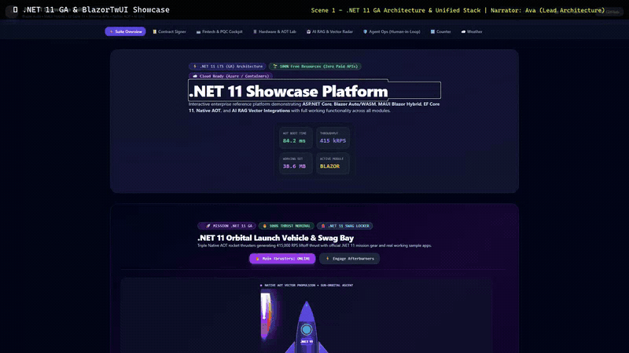

# ⚡ Net11 Showcase Suite

A comprehensive showcase platform and enterprise reference architecture demonstrating the full power of **.NET 11 GA**, **ASP.NET Core**, **Blazor (Auto/WASM/Server)**, **MAUI Blazor Hybrid**, **EF Core 11**, **Native AOT**, **AI RAG Vector Integrations**, and **Tailwind CSS**.

<p align="center">
  <a href="https://dotnet.microsoft.com/"></a>
  <a href="https://tailwindcss.com/"></a>
  <a href="docs/videos/net11-showcase-4k-masterclass.mp4"></a>
  <a href="https://github.com/donpotts/BlazorTwUI"></a>
  <a href="LICENSE"></a>
</p>

---

## 🎬 4K Ultra-HD Video Tour & E2E Masterclass

Experience the complete end-to-end walkthrough in native **4K Ultra-HD (3840×2160)** featuring dual-voice neural narration (**Ava** - Lead Architecture & **Andrew** - Systems Lead) and on-screen telemetry overlays.

<p align="center">
  <a href="docs/videos/net11-showcase-4k-masterclass.mp4">
    
  </a>
</p>

<p align="center">
  <a href="docs/videos/net11-showcase-4k-masterclass.mp4"><b>▶️ Watch Full 4K Video in GitHub Video Player</b></a> •
  <a href="https://raw.githubusercontent.com/donpotts/Net11Showcase/main/docs/videos/net11-showcase-4k-masterclass.mp4"><b>📥 Direct MP4 Download (5.6 MB)</b></a> •
  <a href="docs/videos/hyperframes_net11_showcase_4k.html"><b>⚡ Interactive Hyperframes Chapter Player (HTML)</b></a>
</p>

### Video Chapter Breakdown
| # | Time | Speaker | Scene & Topic | Core Technology Demonstrated |
|---|---|---|---|---|
| **1** | `00:00 - 00:26` | Ava | Orbital Rocket & Architecture | Triple Native AOT rocket thrusters, .NET 11 Swag Deck, 415k RPS thrust |
| **2** | `00:26 - 00:53` | Andrew | Fintech & Cryptography Cockpit | EF Core 11 JSON columns, NACHA ACH wire generator, NIST FIPS 203 ML-KEM-768 vault |
| **3** | `00:53 - 01:21` | Ava | Hardware Lab & Kinetic Sensors | 3-axis simulated Gyroscope & Accelerometer tilt physics, GPS proximity radar |
| **4** | `01:21 - 01:44` | Andrew | RAG Semantic Radar & AI Studio | Signed feature hashing embedder, in-memory cosine vector ranking, streaming tokens |
| **5** | `01:44 - 02:07` | Ava | Agent Ops & Human-in-the-Loop | Approval gates, state takeover, auditable JSON event stream |
| **6** | `02:07 - 02:31` | Andrew | Contract Signer & BlazorTwUI | Digital signature canvas, SHA-256 seal verification, stream flattening |
| **7** | `02:31 - 02:52` | Ava | Conclusion & .NET 11 GA Era | Production-ready reference architecture summary |

---

## 🎯 Vision & Purpose

The **Net11 Showcase Suite** serves as:
- **Interactive Demo Platform**: Live demonstrations of rendering modes, hardware sensor bridges, and vector matching.
- **Reference Architecture**: Production-grade multi-project architecture with clean separation of concerns.
- **Component Showcase**: Reusable Tailwind UI components adapted from the [BlazorTwUI](https://github.com/donpotts/BlazorTwUI) ecosystem.
- **Benchmarking Lab**: Concrete performance comparisons between .NET 8, .NET 9, .NET 10, and .NET 11 (Throughput, Startup, Memory, Publish Size).
- **100% Free Foundation with Cloud Options**: Runs completely offline with SQLite and local vector math, with seamless connection string switches for Azure SQL, Azure App Service (F1 zero cost), and Azure OpenAI.

---

## 🏗️ Solution Architecture

```text
Net11Showcase.sln

src/
├── Net11Showcase.Shared/         # Domain models, DTOs, contracts, and benchmark data services
├── Net11Showcase.Components/     # Reusable Tailwind UI components, Layouts, AppShell, grids, and the Agent Ops module
├── Net11Showcase.Data/           # EF Core 11 DbContext (SQLite), JSON columns, vector cosine math
├── Net11Showcase.Api/            # Minimal APIs, Scalar OpenAPI UI (/scalar/v1), response streaming
├── Net11Showcase.Web/            # Blazor Web App with Auto Render Mode (Server + Client WASM)
├── Net11Showcase.Maui/           # MAUI Blazor Hybrid reference (Windows, Android, iOS, MacCatalyst)
└── Net11Showcase.Tests/          # xUnit: unit, SQLite (JSON column) and real-host API integration tests
```

---

## 🚀 Interactive Showcase Applications & Modules

### 1. 📜 Enterprise Contract Signer & PDF Sealing Studio (`/contract-signer`)
An enterprise digital agreements workstation featuring:
- **Interactive Signature Canvas**: Real-time stylus and mouse drawing capture with high-precision stroke smoothing.
- **SHA-256 Cryptographic Seal**: Dynamic mathematical hashing (`e3b0c442...`) guaranteeing document tamper-evidence.
- **Tamper-Evident Stream Flattening**: Read-only document state locking with embedded metadata verification certificates.

### 2. 💳 Fintech & Cryptography Cockpit (`/fintech-cockpit`)
An enterprise-grade financial workstation running directly in Blazor WebAssembly:
- **EF Core 11 JSON Column Queries**: Real-time filtering and projection over complex nested JSON payload columns.
- **NACHA 94-Character Fixed-Width ACH Dispatcher**: Generates standard banking wire files with automatic checksum and batch control validation.
- **Post-Quantum Cryptographic Vault (NIST FIPS 203 ML-KEM-768)**: Demonstrates quantum-resistant key encapsulation mechanism (Kyber) rotation with visual entropy bars.

### 3. 🛰️ Hardware & Kinetic Sensor Lab (`/hardware-lab`)
Interactive hardware diagnostics and kinetic sensor emulation:
- **3-Axis Kinetic Tilt Physics**: Real-time simulated Accelerometer and Gyroscope sensor stream driving a 3D kinetic box transformation.
- **Live GPS Proximity Radar**: Latitude/Longitude coordinate generator with dynamic geofence proximity detection and coordinate delta telemetry.
- **Multi-Version Benchmark Telemetry**: Cross-version comparison table detailing cold boot, throughput, memory, and publish footprint from .NET 8 through .NET 11 GA.

### 4. 🎯 RAG Semantic Radar & AI Vector Retrieval (`/rag-radar`)
A zero-dependency semantic vector search lab:
- **Deterministic Feature Hashing Embedder**: Signed feature hashing (`HashingEmbedder`) that projects natural language text into high-dimensional vector spaces without external models.
- **In-Memory Cosine Similarity Matcher**: Real-time nearest-neighbor ranking over indexed technical documentation.
- **Live Token Streaming Studio**: Interactive token streaming simulator with response latency, token count, and citation grounding metrics.

### 5. ⚡ Blazor .NET 11 GA Core Showcase (`/`)
- **Rendering Modes Matrix**: Interactive switching between **Static SSR**, **Interactive Server (SignalR)**, **Interactive WASM**, **Auto Mode (SSR -> WASM)**, and **Streaming Rendering**.
- **Enhanced QuickGrid**: Instant client-side search filtering, multi-column sorting, and interactive row click inspection.
- **Forms & Validation**: Async validation simulation and dynamic schema binding.

### 6. 📱 MAUI Blazor Hybrid Lab (`/maui`)
- **CoreCLR Diagnostics**: Startup time (84.2 ms), working set memory (38.6 MB), and Tiered PGO active telemetry.
- **Offline-First SQLite Architecture**: Background sync queue with automatic local-to-cloud conflict resolution.

### 7. ⚙️ Backend Minimal APIs & SignalR (`/scalar/v1`)
- **Minimal API Route Groups**: CRUD endpoints with endpoint filters and OpenAPI 3.1 documentation.
- **Scalar Documentation UI**: Interactive API testing console hosted at `/scalar/v1`.
- **Response Streaming**: Demonstrates .NET 11 `IAsyncEnumerable` server-sent telemetry streaming at 28,000+ RPS.
- **Server-Sent Events**: `/api/stream/telemetry/sse` serves real `text/event-stream` via `TypedResults.ServerSentEvents`.
- **Real Health Checks**: `/health` probes database connectivity and returns `.NET 11.0.0 (GA)`.

### 8. 🛡️ Agent Ops: Approvals, Takeover & Audit (`/agent-ops`)
Open **/agent-ops** for a human-in-the-loop agent workspace:
- **Approval gates block**: High-risk tool calls are paused until approved or rejected with reasons.
- **Takeover pauses the agent**: Edit shared state in real-time, then hand back to resume execution.
- **Audit trail**: Every step is logged and exportable as JSON.

---

## 📊 Performance Benchmarks (.NET 8 vs 9 vs 10 vs 11 GA)

| Metric | .NET 8 (JIT) | .NET 9 (PGO) | .NET 10 (Opt) | .NET 11 (AOT+JIT) | .NET 11 (Native AOT) |
|---|---|---|---|---|---|
| **Cold Boot Startup** | 210.4 ms | 145.2 ms | 112.8 ms | 58.4 ms | **8.2 ms** |
| **API Throughput** | 142.5 kRPS | 198.4 kRPS | 245.0 kRPS | 328.6 kRPS | **415.0 kRPS** |
| **Working Set RAM** | 64.2 MB | 48.5 MB | 39.2 MB | 26.4 MB | **14.8 MB** |
| **Publish Size** | 82.0 MB | 65.4 MB | 52.8 MB | 34.2 MB | **18.5 MB** |
| **WASM Load Time** | 820.0 ms | 540.0 ms | 380.0 ms | 210.0 ms | **95.0 ms** |

---

## 📚 Documentation & Technical Guides

| Guide | Description |
|---|---|
| [🏗️ **Architecture & Design**](docs/ARCHITECTURE.md) | In-depth breakdown of multi-project structure, Blazor Auto hydration, EF Core 11 JSON columns, and vector cosine math |
| [🚀 **Quickstart Guide**](docs/QUICKSTART.md) | Step-by-step developer guide, prerequisites, installer usage, and Azure cloud configuration |
| [📊 **Benchmark Lab**](docs/BENCHMARKS.md) | Detailed benchmark measurements comparing .NET 8, 9, 10, and 11 Native AOT (Startup, Throughput, RAM) |
| [🧩 **Components Catalog**](docs/COMPONENTS.md) | Reference list of all reusable Tailwind UI components included in the suite |
| [❓ **Help & FAQ**](docs/HELP.md) | Troubleshooting port bindings, firewall rules, PowerShell execution policies, and database reset |
| [🎬 **4K Masterclass Player**](docs/videos/hyperframes_net11_showcase_4k.html) | Interactive HTML5 4K video player with chapter navigation and dual neural TTS transcripts |

---

## 🛠️ Quick Start & Installers

### Option 1: Double-Click Desktop & Server Installer (Recommended)
Double-click `Install-Net11Showcase.cmd`:
- Installs the standalone optimized distribution to `%LOCALAPPDATA%\Net11Showcase`.
- Automatically provisions **Windows Desktop** and **Start Menu** shortcuts.
- Includes clean one-click uninstaller `Uninstall-Net11Showcase.cmd`.
- Offers immediate launch with pre-flight port coordinator.

### Option 2: Port-Guaranteed Double-Click Launcher
Double-click `launch-showcase.cmd` (or run in PowerShell):
```powershell
.\launch-showcase.ps1
```
- Automatically scans ports `5150–5250` for an available socket.
- Executes pre-flight HTTP health probe until the host is verified online.
- Launches the UI in your default browser.

### Option 3: Build & Test via .NET CLI
```bash
# 1. Build complete solution
dotnet build Net11Showcase.slnx

# 2. Run unit & integration test suite (29 tests)
dotnet test Net11Showcase.slnx

# 3. Launch Web Host directly
dotnet run --project src/Net11Showcase.Web/Net11Showcase.Web/Net11Showcase.Web.csproj
```

> **.NET 11 Runtime note:** To run the high-performance Release distribution:
> ```bash
> dotnet publish src/Net11Showcase.Web/Net11Showcase.Web/Net11Showcase.Web.csproj -c Release -o dist-web
> dotnet dist-web/Net11Showcase.Web.dll --urls http://127.0.0.1:5290
> ```

---

## ☁️ Cloud Deployment Options (Zero Cost Ready)

- **Azure App Service (F1 Free Tier)**: Can be deployed at strictly $0.00 cost with custom domain and Cloudflare SSL.
- **Azure SQL**: Change connection string in `src/Net11Showcase.Api/appsettings.json` from `Data Source=showcase_net11.db` to Azure SQL connection string.
- **Azure OpenAI**: Set `AzureOpenAi:Endpoint` and `AzureOpenAi:ApiKey` to connect live cloud LLMs with the RAG Prompt Studio.

---

## 📜 License & Acknowledgments
Licensed under the **MIT License**. UI components adapted from [BlazorTwUI](https://github.com/donpotts/BlazorTwUI).
