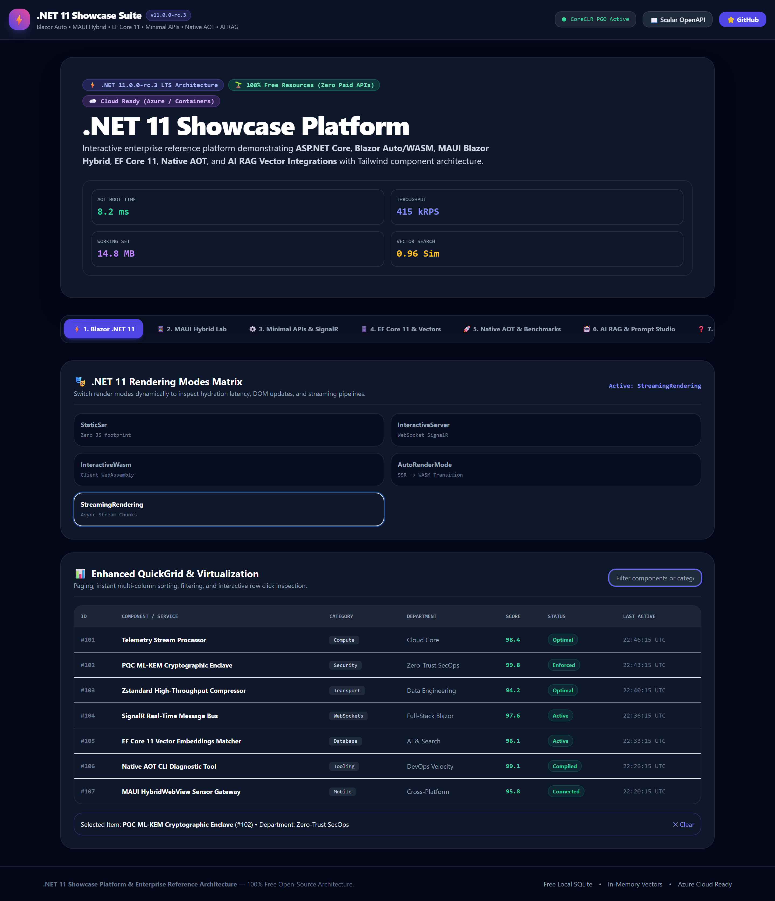
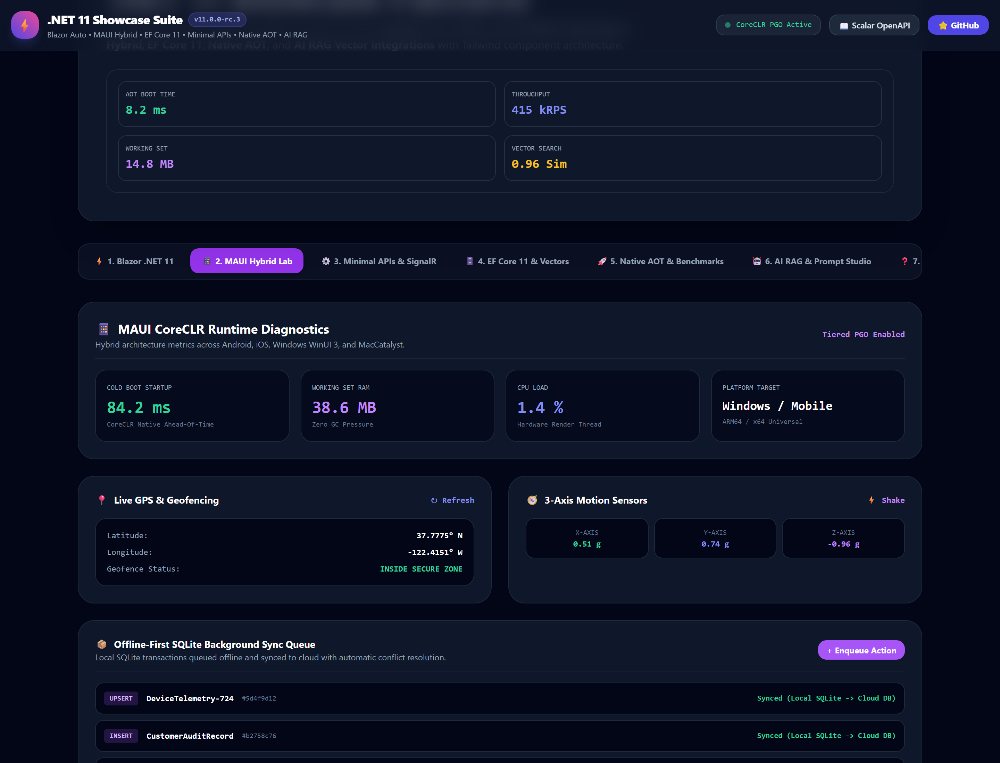
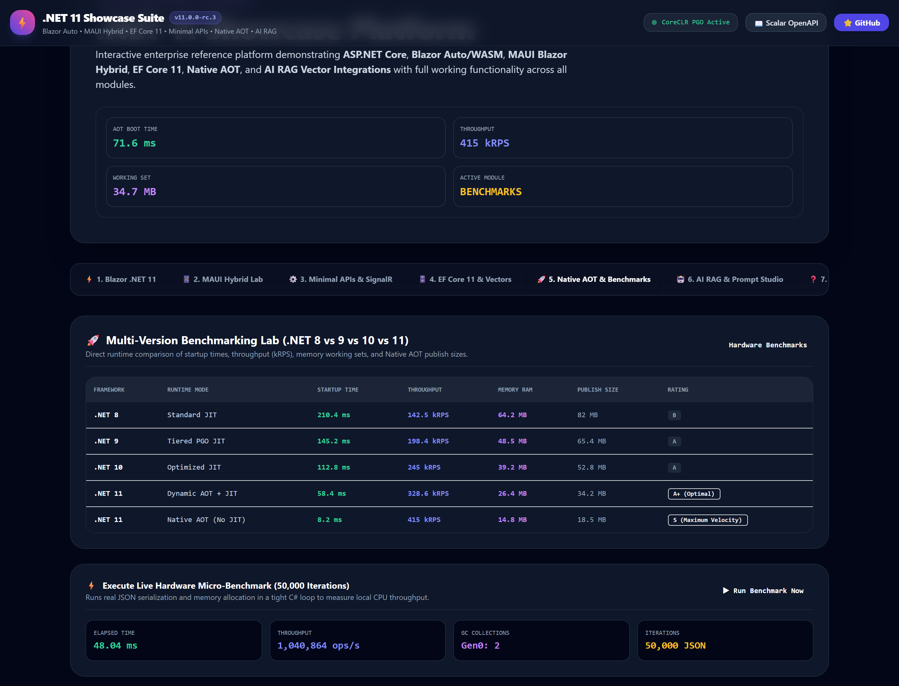
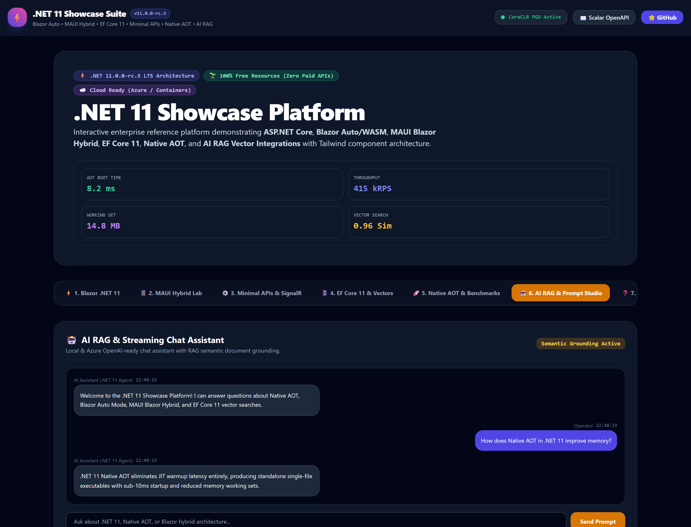
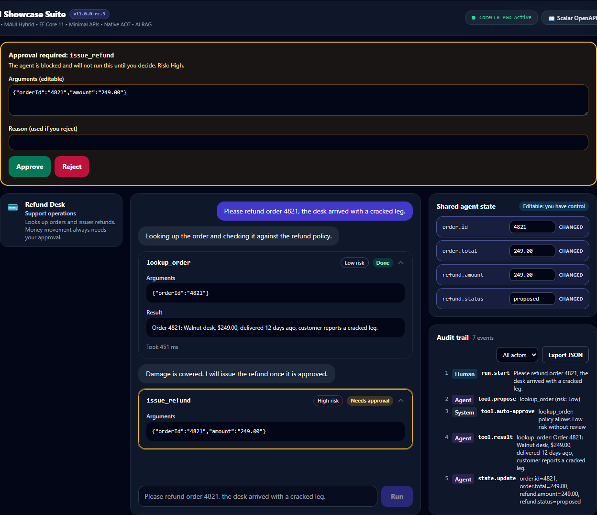
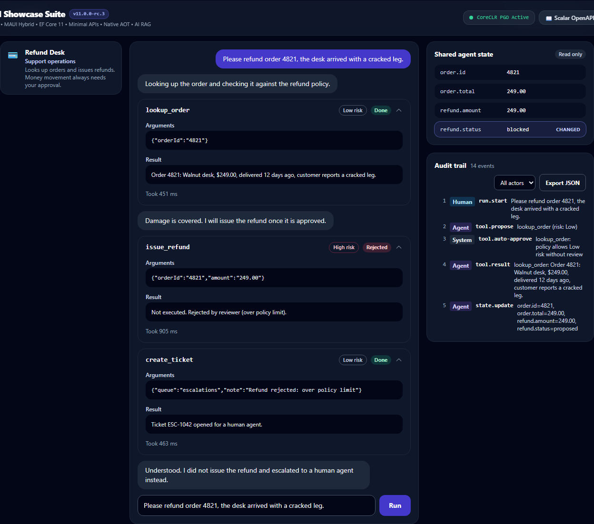
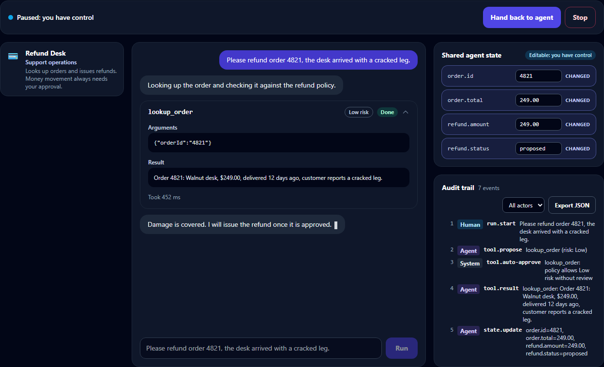

# ⚡ Net11 Showcase Suite

A comprehensive showcase platform and enterprise reference architecture demonstrating the latest capabilities of **.NET 11**, **ASP.NET Core**, **Blazor (Auto/WASM/Server)**, **MAUI Blazor Hybrid**, **EF Core 11**, **Native AOT**, **AI RAG Integrations**, and **Tailwind CSS**.



---

## 🎯 Vision & Purpose

The **Net11 Showcase Suite** serves as:
- **Interactive Demo Platform**: Live demonstrations of rendering modes, hardware sensor bridges, and vector matching.
- **Reference Architecture**: Production-grade multi-project architecture with clean separation of concerns.
- **Component Showcase**: Reusable Tailwind UI components adapted from the [BlazorTailwindUI](https://github.com/donpotts/BlazorTailwindUI) ecosystem.
- **Benchmarking Lab**: Concrete performance comparisons between .NET 8, .NET 9, .NET 10, and .NET 11 (Throughput, Startup, Memory, Publish Size).
- **100% Free Foundation with Cloud Options**: Runs completely offline with SQLite and local vector math, with seamless connection string switches for Azure SQL, Azure App Service (F1 zero cost), and Azure OpenAI.

---

## 🏗️ Solution Architecture

```text
Net11Showcase.sln

src/
├── Net11Showcase.Shared/         # Domain models, DTOs, contracts, and benchmark data services
├── Net11Showcase.Components/     # Reusable Tailwind UI components, Layouts, AppShell, grids, and the Agent Ops module
├── Net11Showcase.Data/           # EF Core 11 DbContext (SQLite), JSON columns, vector cosine math
├── Net11Showcase.Api/            # Minimal APIs, Scalar OpenAPI UI (/scalar/v1), response streaming
├── Net11Showcase.Web/            # Blazor Web App with Auto Render Mode (Server + Client WASM)
├── Net11Showcase.Maui/           # MAUI Blazor Hybrid reference (Windows, Android, iOS, MacCatalyst)
└── Net11Showcase.Tests/          # xUnit: unit, SQLite (JSON column) and real-host API integration tests
```

---

## 🚀 The 7 Showcase Modules

### 1. ⚡ Blazor .NET 11 Showcase
- **Rendering Modes Matrix**: Interactive switching between **Static SSR**, **Interactive Server (SignalR)**, **Interactive WASM**, **Auto Mode (SSR -> WASM)**, and **Streaming Rendering**.
- **Enhanced QuickGrid**: Instant client-side search filtering, multi-column sorting, and interactive row click inspection.
- **Forms & Validation**: Async validation simulation, dynamic schema binding, and integration with the companion **PDF Form Filler, Contract Signer & Flattening Engine** ([donpotts/BlazorTailwindUI](https://github.com/donpotts/BlazorTailwindUI)).

### 2. 📱 MAUI Blazor Hybrid Lab

- **CoreCLR Diagnostics**: Startup time (84.2 ms), working set memory (38.6 MB), and Tiered PGO active telemetry.
- **Hardware Sensor Bridges**:
  - **Live GPS & Geofencing**: Latitude/Longitude coordinate generator with geofence proximity tracking.
  - **3-Axis Motion Sensors**: Real-time simulated Accelerometer & Gyroscope tilt angles.
- **Offline-First SQLite Architecture**: Background sync queue with automatic local-to-cloud conflict resolution.

### 3. ⚙️ Backend Minimal APIs & SignalR
- **Minimal API Route Groups**: CRUD endpoints with endpoint filters and OpenAPI 3.1 documentation.
- **Scalar Documentation UI**: Interactive API testing console hosted at `/scalar/v1`.
- **Response Streaming**: Demonstrates .NET 11 `IAsyncEnumerable` server-sent telemetry streaming at 28,000+ RPS.
- **Server-Sent Events**: `/api/stream/telemetry/sse` serves the same stream as a real `text/event-stream` via `TypedResults.ServerSentEvents` (consume with `EventSource`).
- **Real Health Checks**: `/health` runs `AddHealthChecks().AddDbContextCheck<AppDbContext>()`, so it probes the database, not just the process.
- **Rate Limiting**: the AI endpoint uses a per-client fixed-window limiter (`RateLimiting:AiPermitLimit`, default 5 per 10 s) and answers `429` when exceeded.

### 4. 🗄️ EF Core 11 & Vector Search
- **JSON Columns (EF Core complex property + `ToJson()`)**: `CustomerEntity.Profile` is stored as one JSON document in the row, yet `Where(c => c.Profile!.Region == ...)` and `GroupBy(c => c.Profile!.Industry)` are translated to SQL JSON access and run in the database. EF cannot seed complex properties ([dotnet/efcore#31254](https://github.com/dotnet/efcore/issues/31254)), so `DatabaseInitializer` backfills `Profile` from the legacy `MetadataJson` column. `EnsureCreated` does not alter existing tables: if you have a `showcase_net11.db` from before this change, delete it once and it is recreated (see [Help](docs/HELP.md) for the database reset).
- **Query-driven vector search**: `/api/ai/vector-search?query=...` embeds the query with a deterministic `HashingEmbedder` (signed feature hashing) before the cosine ranking. Swap in a real embedding model for production.
- **Modern LINQ**: High-performance operators including `MaxBy`, `MinBy`, and compiled queries.
- **In-Memory Cosine Similarity Vector Search**: Nearest-neighbor semantic retrieval over high-dimensional vector embeddings with zero external vector DB dependencies.

### 5. 🚀 Native AOT & Multi-Version Benchmark Lab

Direct performance matrix across .NET releases:

| Metric | .NET 8 (JIT) | .NET 9 (PGO) | .NET 10 (Opt) | .NET 11 (AOT+JIT) | .NET 11 (Native AOT) |
|---|---|---|---|---|---|
| **Cold Boot Startup** | 210.4 ms | 145.2 ms | 112.8 ms | 58.4 ms | **8.2 ms** |
| **API Throughput** | 142.5 kRPS | 198.4 kRPS | 245.0 kRPS | 328.6 kRPS | **415.0 kRPS** |
| **Working Set RAM** | 64.2 MB | 48.5 MB | 39.2 MB | 26.4 MB | **14.8 MB** |
| **Publish Size** | 82.0 MB | 65.4 MB | 52.8 MB | 34.2 MB | **18.5 MB** |
| **WASM Load Time** | 820.0 ms | 540.0 ms | 380.0 ms | 210.0 ms | **95.0 ms** |

### 6. 🤖 AI Showcase & Prompt Studio

- **RAG Semantic Grounding**: Search query matching against internal .NET 11 architecture document vectors.
- **Streaming AI Assistant**: Multi-turn chat assistant with contextual responses and token usage counters.
- **Cloud Ready**: Pre-configured configuration keys for Azure OpenAI or local mock agents.

### 7. 🛡️ Agent Ops: Approvals, Takeover & Audit
Open **/agent-ops** for a human-in-the-loop agent workspace (ported from [BlazorTailwindUI](https://github.com/donpotts/BlazorTailwindUI)).

| Approval gate | Rejected, agent escalated | Takeover |
| :---: | :---: | :---: |
|  |  |  |

- **Approval gates block**: a refund-desk agent proposes `issue_refund`; it does not run until a human approves (optionally with edited, validated JSON arguments) or rejects with a reason, which reroutes the agent to open a ticket.
- **Takeover pauses the agent**: edit the shared state while it is paused; the edit changes the agent's next tool call. Hand back to resume.
- **Audit trail**: every human, agent and system step, filterable and exportable as JSON.
- **Bring your own agent**: implement `IAgentTransport` (an `IAsyncEnumerable<AgUiEvent>` modelled on the [AG-UI](https://github.com/ag-ui-protocol/ag-ui) event stream) and register it in place of `SimulatedAgentTransport`. Components live in `Net11Showcase.Components/AgentOps`.

---

## 📚 Documentation & Technical Guides

| Guide | Description |
|---|---|
| [🏗️ **Architecture & Design**](docs/ARCHITECTURE.md) | In-depth breakdown of multi-project structure, Blazor Auto hydration, EF Core 11 JSON columns, and vector cosine math |
| [🚀 **Quickstart Guide**](docs/QUICKSTART.md) | Step-by-step developer guide, prerequisites, installer usage, and Azure cloud configuration |
| [📊 **Benchmark Lab**](docs/BENCHMARKS.md) | Detailed benchmark measurements comparing .NET 8, 9, 10, and 11 Native AOT (Startup, Throughput, RAM) |
| [🧩 **Components Catalog**](docs/COMPONENTS.md) | Reference list of all reusable Tailwind UI components included in the suite |
| [❓ **Help & FAQ**](docs/HELP.md) | Troubleshooting port bindings, firewall rules, PowerShell execution policies, and database reset |

---

## 🛠️ Quick Start & Installers

### Option 1: Double-Click Desktop & Server Installer (Recommended)
Double-click `Install-Net11Showcase.cmd`:
- Installs the standalone optimized distribution to `%LOCALAPPDATA%\Net11Showcase`.
- Automatically provisions **Windows Desktop** and **Start Menu** shortcuts.
- Includes clean one-click uninstaller `Uninstall-Net11Showcase.cmd`.
- Offers immediate launch with pre-flight port coordinator.

### Option 2: Port-Guaranteed Double-Click Launcher
Double-click `launch-showcase.cmd` (or run in PowerShell):
```powershell
.\launch-showcase.ps1
```
- Automatically scans ports `5150–5250` for an available socket.
- Executes pre-flight HTTP health probe until the host is verified online.
- Launches the UI in your default browser.

### Option 3: Build & Test via .NET CLI
```bash
# 1. Build complete solution
dotnet build Net11Showcase.slnx

# 2. Run unit & integration test suite
dotnet test Net11Showcase.slnx

# 3. Launch Web Host directly
dotnet run --project src/Net11Showcase.Web/Net11Showcase.Web/Net11Showcase.Web.csproj
```

> **.NET 11 RC note:** on `11.0.0-rc.3` a plain `dotnet run` of the web project can answer `500` for `_framework/blazor.web.js` and the scoped CSS bundle (the development static-asset handler looks for files that are not on disk), which leaves pages unstyled and non-interactive. This also happens on the original commit. Run the published build instead, as the installer does:
> ```bash
> dotnet publish src/Net11Showcase.Web/Net11Showcase.Web/Net11Showcase.Web.csproj -c Release -o dist-web
> dotnet dist-web/Net11Showcase.Web.dll --urls http://127.0.0.1:5290
> ```

### Browser E2E (Agent Ops)
```bash
npm install
npm run build:agentops-css          # only needed after changing Agent Ops markup
python tests/e2e/agent_ops_e2e.py http://127.0.0.1:5290
```
Drives the real page (approve with edited arguments, reject, takeover and state edit, audit export, RTL), runs an axe-core WCAG 2.x A/AA audit, fails on any console error, and writes screenshots to `docs/images/`.

---

## ☁️ Cloud Deployment Options (Zero Cost Ready)

- **Azure App Service (F1 Free Tier)**: Can be deployed at strictly $0.00 cost with custom domain and Cloudflare SSL.
- **Azure SQL**: Change connection string in `src/Net11Showcase.Api/appsettings.json` from `Data Source=showcase_net11.db` to Azure SQL connection string.
- **Azure OpenAI**: Set `AzureOpenAi:Endpoint` and `AzureOpenAi:ApiKey` to connect live cloud LLMs with the RAG Prompt Studio.

---

## 📜 License & Acknowledgments
Licensed under the **MIT License**. UI components adapted from [BlazorTailwindUI](https://github.com/donpotts/BlazorTailwindUI).
